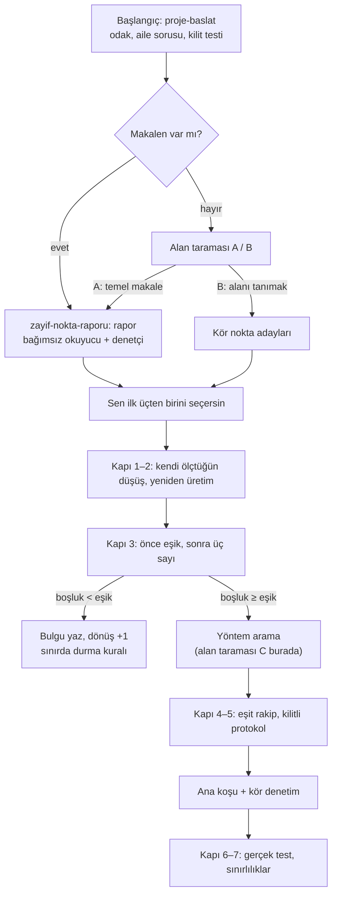

# Araştırma şablonu

Her yeni araştırma projesi bu şablonla başlar. Amaç, tekrar eden hataları (önce yöntem, geç gelen basit rakip,
eşitsiz rakip, sonradan değişen kural, az tohum, durmayan dönüşler, yalnız benzetim, silinen sınırlılık, çok proje,
basit kuralın kazandığı koşula dönüş) yapı düzeyinde önlemek. Kurallar geneldir: belirli bir makaleye, koşula ya da
kişiye bağlı değildir. Şablonu kim kullanırsa kullansın kendi verisi kendi **kişisel klasöründe** durur (aşağıda).

## Kurulum (her bilgisayarda bir kez)

```bash
git clone https://github.com/burhanbarakli/arastirma-sablonu.git ~/CALISMALAR/_arastirma-sablonu
sh ~/CALISMALAR/_arastirma-sablonu/kur.sh
```

Windows'ta (PowerShell):

```powershell
git clone https://github.com/burhanbarakli/arastirma-sablonu.git $HOME\CALISMALAR\_arastirma-sablonu
powershell -ExecutionPolicy Bypass -File $HOME\CALISMALAR\_arastirma-sablonu\kur.ps1
```

`kur` betiği üç skill'i (`zayif-nokta-raporu`, `arastirma-kapisi`, `proje-baslat`) `~/.claude/skills/` altına kurar,
şablonun yerini `~/.claude/arastirma/sablon_yolu.txt` dosyasına yazar ve kişisel klasörünü hazırlar.

## Kişisel klasör

Şablon herkes için aynıdır; senin verin şablonda değil, kişisel klasöründe durur. Varsayılan yeri şablonun yanındaki
`_arastirma-kisisel` klasörüdür. `kur` betiği yoksa onu oluşturur, eksik dosyaları `kisisel-ornek/`'ten kopyalar
(var olana dokunmaz) ve yolunu `~/.claude/arastirma/kisisel_yolu.txt`'ye yazar. İçinde üç dosya var:

- `kaynak.json`: makinen ve kaynak sınırların. "İzin yok" listesine uyan çalışma haritada kalır ama temel makale ya
  da deney adayı olamaz; Kapı 2'de böyle bir koşu DUR alır. "İlk tercih değil" listesine uyanlar dışlanmaz, okuma ve
  deney seçiminde sona gider. "İzin verilen" (örneğin WSL2'de CUDA) uygun sayılır. Listeler boşsa sınır yoktur. İlk
  iş bunu doldur.
- `kapali_kapilar.json`: kapalı kapıların, yani eşik altında kalan ya da basit çarenin yettiği koşullar. Aile kontrolü
  buradan okur.
- `gecmis.md`: kendi hataların ve örnekleri. Kapı bir kararda "senin şu projendeki gibi" derken örneği buradan alır.

Birden çok bilgisayarda çalışıyorsan kişisel klasörü özel bir git deposu yap. Öbür bilgisayarda önce onu klonla,
sonra kur betiğini klasörün yoluyla çalıştır (`sh kur.sh <yol>` ya da `kur.ps1 -Kisisel <yol>`).

## Bu şablonu başkasıyla paylaşmak (öğrenci, ekip arkadaşı)

1. Depoyu klonlasın ve `kur` betiğini çalıştırsın. Boş bir kişisel klasör oluşur.
2. `kaynak.json`'a kendi makinesini yazsın; `gecmis.md` ile `kapali_kapilar.json` boş başlar ve projeleriyle dolar.
3. `docs/vakalar/` ve `docs/NEDEN.md`'deki proje adları şablonu yazanın projeleridir. Kurallar oradaki hatalardan
   doğdu; okumak öğreticidir, ama skill bunları yeni kullanıcının geçmişi saymaz, yalnız "örnek vaka" diye anar.
4. Skill'i değiştirmek isterse kendi kopyasında (fork) yapsın; bu depoya değişiklik isteğiyle önerebilir.

**Güncelleme (iki makinede de):** `git pull`, ardından `kur` betiğini yeniden çalıştır. Skill'lerde bir değişiklik yapacaksan bu
depodaki `skills/` klasöründe yap, sonra `kur` betiğini çalıştır ve commit et. Doğru kaynak bu depodur.

## Yeni proje açmak

Claude Code'da, projenin açılacağı klasörde:

```
/proje-baslat
```

ya da "yeni bir araştırma projesi başlat" demen yeterli. Yan iş (örneğin bir alan taraması) de böyle açılır.
`proje-baslat` skill'i:
1. odağı denetler: bir ana proje, bir yan iş; kayıt boşsa başka makinedeki projeleri sorar;
2. bu klasördeki dosyaları yeni projeye kopyalar (kişisel klasör kopyalanmaz, okunur);
3. `git init` yapar ve `tools/karar_koruma.py`'ı commit kancası olarak kurar;
4. senden proje adını, temel yöntemi (ve koşmak için neye ihtiyaç duyduğunu), şüphelendiğin koşulu ve bu koşulun
   daha önce çalışılıp çalışılmadığını alır; `karar.json`'ı doldurur;
5. projeyi `~/.claude/arastirma/projeler.json` kaydına ekler ve `durum.html` panelini üretir;
6. ilk commit'ten sonra kilidin **engellediğini** sınar.

## Akış



Hangi işe hangi skill'le başlanır:

| İş | Başlangıç |
|---|---|
| Yeni çalışma, yan iş dahil | `proje-baslat` (odak ve aile kontrolü okumadan önce) |
| Elinde bir makale var | `zayif-nokta-raporu` rapor modu; tek tek dinlemek istersen "anlatımlı okuma" |
| Alanı tanımak ya da temel makale bulmak | `zayif-nokta-raporu` alan taraması, amaç B ya da A |
| "Bunu kim çözmüş?" | `arastirma-kapisi`: yalnız Kapı 3'ten sonra, yöntem arama ya da aktarım kontrolü içinden (alan taraması C). Önce istenirse DUR |
| Yöntem önerisi, yeni koşul, kural değişikliği, gönderim | `arastirma-kapisi` |

Aşamalar ve panelde görünenler:

| Aşama | Skill | Panelde |
|---|---|---|
| 0. Okuma | `zayif-nokta-raporu` | Raporun yolu |
| 1. Soru | `arastirma-kapisi` | Ölçülmüş bozulma, tez cümlesi |
| 2. Yeniden üretim | `arastirma-kapisi` | Makalenin sayısına karşı bizimki |
| 3. Üç sayı | `arastirma-kapisi` | Taban, basit çare, adil kâhin, boşluk |
| 4. Rakip adaleti | `arastirma-kapisi` | Bütçe, ayar, bilgi eşitliği |
| 5. Protokol | `arastirma-kapisi` | Karar kuralı, tohum, durma kuralı |
| Ana koşu | | Tohum planı / koşulan |
| 6. Gerçeklik ve tavan | `arastirma-kapisi` | Benzetim kusursuzlukları, gerçek test |
| Kör denetim | | Sonucu bilmeyen yeniden hesap |
| 7. Yazım | `arastirma-kapisi` | Sınırlılıklar |

## Nasıl başlarım, nasıl devam ederim

1. **Projeyi kur.** Yeni klasörde Claude Code'da `/proje-baslat`. Soruları cevapla: proje adı ve amacı; temel makale,
   kodu ve koşmak için ne istediği; şüphelendiğin koşul; bu koşul daha önce çalışıldı mı. Daha önce basit bir kural
   kazandıysa "bu kez neden farklı?" sorusuna ölçülebilir bir cevap gerekir. `durum.html` paneli açılır.
2. **Makalen yoksa alanı tara.** "alan taraması: konu". Amaç A (temel makale) ya da B (alanı tanımak); yöntem adı
   geçmeyen bir arama cümlesi; sonra kartopu, eleme tablosu (kaynak uyumu sütunuyla), doğrulama, durma kuralı.
   Ayrıntı: aşağıdaki "Makale arama (alan taraması)" bölümü.
3. **Makaleyi ver.** "zayıf nokta raporu: makale.pdf". Sohbeti ve şüpheni görmeyen bir ajan okur, denetçi ajan kontrol
   eder; açık rapor gelir. Bulguları tek tek, okunacak yeriyle dinlemek istersen "anlatımlı okuma" (ya da "şurayı oku
   de"). Okuma sırasında çıkan yöntem fikirleri "Fikirler (park edildi)" altına yazılır, geliştirilmez.
4. **Gösterilen yerleri oku.** İddiaları yargılamak isteğe bağlı; getirirsen kontrol edilir, `okuma-gunlugu.md`'ye
   işlenir. Literatürden, oyuncaktan ya da ajanın çıkarımından gelen düşüş ölçülecek bir hipotezdir, bozulma değil.
5. **Zayıf noktayı sen seç.** Rapor ilk üç zayıf noktayı en ucuz deneyleriyle verir; birini sen seçersin.
   Kişisel `kaynak.json`'daki "izin yok" maddelerine uyanlar aday olamaz, "ilk tercih değil" olanlar sona gider.
6. **Kapıya sor.** "kapı" / "doğru yolda mıyım?". Kapı 1 düşüşü senin ölçmeni ister: resmî ya da yeniden üretilmiş
   kodda, stres yokken sayı makaledekiyle yan yana, koşul yöntemden önce yazılmış, düşüş tohum dağılımından büyük.
7. **Kapı 3: önce eşik, sonra üç sayı.** Taban, en güçlü basit çare (en az üç aday, yöntemi bilmeyen bir ajandan;
   en güçlüsüne yönteme verilecek ayar taraması), adil kâhin. Boşluk eşiğin altındaysa bulgu yaz; başka koşula geçmek
   dönüştür.
8. **Boşluk kalırsa yöntem ara.** "yeni yöntem bul": kâhin ne biliyor, basit çareler, boşluğun nedeni, gereken
   özellik, kim çözmüş (alan taraması C), şeytanın avukatı, adil kâhinli en küçük test.
9. **Kapıları sırayla geç.** Rakip adaleti, protokol (`karar.json > protokol`, kilitli), ana koşu, kör denetim,
   gerçeklik. Benzetimde doğrulanan sonuçtan sonraki adım gerçek test ya da "iddia benzetimle sınırlı" Sapması.
10. **Yazım.** Kapı 7: gerçek test ya da Sapma, açık KOŞULLU yok, makaledeki sınırlılıklar kayıtla satır satır aynı,
    kör denetim yapılmış (`paper-critique`, `citation-check` yardımcı).

## Aktarım çalışması: yeni bir yöntemi var olan M'nin yerine koymak

İki tür çalışma var; `proje-baslat` hangisi olduğunu sorar (`karar.json > calisma_turu`):

- **boşluk:** ölçülmüş bir düşüş bir yöntem için yer bırakıyor mu? Yukarıdaki akış.
- **aktarım:** güncel ya da başka alandan bir yöntem X, var olan güçlü yöntem M'nin yerine, M'nin ölçülmüş bir
  darboğazı için konur. Baştan iki sonuç yazılır, ikisi de yayımlanabilir:
  - **Sonuç A (alternatif yöntem):** X, ana ölçütte M'den en fazla δ geride ve önceden yazılmış tek avantaj
    ekseninde en güçlü basit alternatiften en az ε önde.
  - **Sonuç B ("X gerekli mi?"):** basit alternatif X kadar iyi; X'in eksendeki ε kadar üstünlüğü dışlandı.
  - Başka her şey **belirsiz**. "Fark çıkmadı" eşdeğerlik değildir.

Aktarımda yol:
1. `/proje-baslat`, tür: aktarım. Aklındaki yöntem KARAR.md'ye fikir olarak yazılır, aday listesine girmez.
2. M'nin makalesine `zayif-nokta-raporu`. Oradan gelen darboğaz bir hipotezdir.
3. **Kapı A1:** M'nin darboğazını kendi koşunda ölç. Sonra, hiçbir aday adı geçmeden ekseni (ölçülen bir davranış,
   adayın eğitim hedefi değil), ölçütünü, δ'yı (en fazla ½·(M − taban)), ε'u ve iki sonuç cümlesini yaz, commit et.
   Commit kilidi, bunlar yokken aday yazılmasını engeller.
4. **Kapı 2:** M'yi makalenin sayısına yakın üret (kaynak sınırı burada).
5. **Kapı A3:** taban, M ve en az üç basit alternatif; biri mutlaka "M + ilkenin ucuz eki" (fizik kaybı, conformal
   sarmalayıcı, veri artırma, küçültülmüş M…). Basit alternatif zaten yetiyorsa bulgu: B yazılır.
6. **Aday seçimi:** "aday havuzu" (alan taraması D) ile güncel ve klasik adaylar; her biri için gerekçe, beklenen
   bozulma, varsayım tablosu, şeytanın avukatı. **En çok iki aday**, öğleden sonralık oyuncak test.
7. **Kapı 4 ve A5:** eşit emek; iki sonuçlu karar kuralı; gereken tohum `python3 tools/aralik.py tohum --delta δ
   --sd s` ile (pilotun sd'sinin üst sınırıyla). Tohum sınırı bunun altındaysa sonuç pilottur.
8. **Ana koşu:** tohum başına eşli farklar → `python3 tools/aralik.py fark …` → aralıklar
   `aktarim.karsilastirmalar`'a; panel A / B / belirsiz / pilot der.
9. **Kapı 6 ve A7:** eksen zor koşulda ya da gerçek testte; yazım sonucun türü kadar ("eşdeğer ve eksende önde",
   ya da B olarak), geride kalınan yerler metinde.

## Kurallar kısaca

- **Pilot:** `protokol.pilot_butcesi` içinde, kodu sınamak ya da protokolü boyutlamak için yapılan koşu. Sayıları
  kapı geçirmez. 3'ten az tohumla alınan her sonuç pilottur.
- **Tohum sınırı:** Bir sınır koyarsan (örneğin 2 tohum) ona uyulur; sonuç pilot sayılır ve sınırlılık olarak yazılır.
  Hazır bir checkpoint'in değerlendirme bölümleri tohum değil denemedir. Eğitim yoksa tohum, farklı başlangıç kümesi
  demektir (`tohum.tanim`) ve fark eşli bölümler üzerinde sınanır; checkpoint'in tek eğitim koşusu sınırlılıktır.
- **Aile kontrolü:** her soruda yapılır, eşleşme yoksa "yok" ve taranan kaynaklar yazılır. Eşik altı kalan ya da basit
  çarenin yettiği koşullar (kapalı kapılar) kişisel klasördeki `kapali_kapilar.json`'a girer; aynı fiziksel koşula dönüş ölçülebilir bir
  öngörü ister.
- **Dönüş:** yeni bir koşula, soruya, göreve ya da yönteme her geçiş; sonuç olumlu olsa da sayılır. Aynı koşulda
  açılan yeni proje sayacı devralır. Sınıra gelince durma kuralı devreye girer.
- **Sapma:** sonuç görüldükten sonra bir kural değişirse `sapmalar`'a tarih, ne değişti ve gerekçeyle yazılır.
  Dürüst kayıttır, başarısızlık değil; panel onu uyarı olarak göstermez.
- **Aşılan karar:** bir kapı kararını aşarsan yardım sürer, `overrides`'a yazılır; ikincisinde danışmanla konuşman
  önerilir.
- **Kilit:** eşik ve protokol ölçümden sonra (ya da ilk ölçümle aynı commit'te) ilk kez yazılamaz; eşiğin birimi de
  kilitli; ölçüm satırları değiştirilemez; sapmalar, dönüşler ve aşılan kararlar silinemez; `karar.json` silinemez.
  Sapma yeni, tarihli ve gerçek gerekçeli olmalı; eski bir sapmanın kopyası ya da "doldurulacak" geçmez. `git revert`
  ve `rebase` commit kancasını çalıştırmaz; uzak depo varsa `pre-push` kancası gönderilen her commit'i denetler.
  Kapı 1'in sorusu, koşul düzeyleri ve eşiği de kilitli: bozulma ilk kez yazılırken bunlar ve tek ölçüt önceki bir
  commit'te bulunmalı. Ölçümü olan eski projeye boş alan eklemek (şema eşitlemesi) engellenmez. Her oturum kancaların
  kurulu olduğuna bakar.
- **Kaynak:** kişisel `kaynak.json`'daki "izin yok" maddelerine uyan çalışma temel makale ya da deney olamaz (Kapı 2:
  DUR; aşılırsa `overrides`'a yazılır). "İlk tercih değil" maddelerine uyanlar dışlanmaz, sıralamada sona gider; yine
  de seçilirse Sapma yazılır.

## Makale arama (alan taraması)

Claude Code'da: **"alan taraması: <konu>"** (ya da "literatür tara", "bu konuda ne var", "temel makale bul"). Bu,
`zayif-nokta-raporu`'nun alan taraması modunu çalıştırır ve aşağıdaki yolu izler.

Önce bir soruyu netleştir: **makaleyi ne için arıyorsun?** "Konuya bak, boşluk bul, yöntem öner" sırası eski
hatalarımızdan biri; arama tam bu hataya kapı açabilir. Amaca göre üç yol var:

| Amaç | Ne ararsın | Çıktı |
|---|---|---|
| **A. Zorlanacak bir temel makale bulmak** | Görevin bugünkü en iyi ya da en yaygın yöntemi | 1–2 makale, sonra `zayif-nokta-raporu` |
| **B. Bir alanı tanımak** | O görev üzerine 5–10 temel makale | Varsayım tablosu ve alanın **kör noktası** |
| **C. Bir özelliği kim çözmüş** (yalnız Kapı 3'ten sonra, yöntem aramanın 5. adımı) | Alan adı geçmeyen bir özellik cümlesi | Başka alanlardan adaylar |

### Yol (özellikle A ve B için)

1. **Arama cümlesini yaz, yöntem adını değil.**
   - Kötü: "diffusion policy makaleleri".
   - İyi: "Gürültülü kuvvet algısıyla temaslı yerleştirme görevini öğrenen politikalar."

   Cümlede görev ve koşul olmalı. Yöntem adı girerse aramanın sonuçları o yönteme kilitlenir.
2. **Tohum makaleler bul.** Bildiğin 2–3 makale ya da bir derleme (survey) yeter. Hiç yoksa Claude cümlenle arar ve
   aday sunar.
3. **Kartopu.** Tohumların **kaynakçasına** (geriye doğru) ve onlara **atıf yapanlara** (ileriye doğru) bakılır. En
   verimli yöntem budur, çünkü alanın gerçekten konuştuğu makaleleri getirir. Araçlar:
   - `citation_neighbours` (OpenAlex): bir makalenin kaynakçasını ve ona atıf yapanları getirir;
   - `paper-search`: anahtar sözcükle arar;
   - `deep-research`: geniş bir tarama gerekirse.
4. **Hızlı eleme.** Başlık ve özetten küçük bir tablo doldurulur. Bu, varsayım tablosunun hafif bir hâli:

   | Makale | Görev | Neyi değiştirmiş | Basit rakip var mı | Gerçek robot mu | Tohum | Kod | Kaynak uyumu |
   |---|---|---|---|---|---|---|---|
   | | | | | | | | |

   "Kaynak uyumu": eğitim mi gerekiyor yoksa hazır checkpoint mi yetiyor, kaç GB GPU, hangi işletim sistemi.

5. **Çekirdeği seç ve derinleş.** 5–10 makale seçilir. Varsayım tablosunun sütunları okumadan önce, genel bir
   listeden sabitlenir (yalnız şüphelendiğin koşuldan değil). PDF'lerden doldurulur. Neredeyse bütün makalelerin aynı
   işaretlediği **her** sütun bir kör nokta adayıdır; adaylar sıralanır, birini sen seçersin. Mesela "hepsi kusursuz
   algı varsayıyor".
6. **Her makale gerçek mi, kontrol et.** Yapay zekâ var olmayan makale uydurabilir. Her makale OpenAlex'te, arXiv'de
   ya da DOI'siyle doğrulanır. Hafızadan gelen hiçbir makale doğrulanmadan kullanılmaz.
7. **Durma kuralı.** Aramaya bir süre koy, mesela 1–2 gün. Yeni makaleler tabloya yeni bir sütun ya da yeni bir bulgu
   eklemiyorsa arama doymuştur, dur.

Sonuç `alan-taramasi-<konu>.md` dosyasına yazılır.

**Örnek vaka:** bir GDA çalışması için kötü ve iyi arama cümleleri, amaç A/B/C ve uyarlanmış eleme tablosu:
[`docs/vakalar/arama-cumlesi-gda.md`](docs/vakalar/arama-cumlesi-gda.md).

> **Dikkat:** Aramanın sonu "**bunu kimse yapmamış**" cümlesine çıkıyorsa, kapı orada DUR der. Kör nokta bir problem
> adayıdır, henüz problem değildir. Doğru sonraki adım: kör noktanın bozduğunu düşündüğün yöntemi seçip o koşulda
> bozulmayı ölçmek (Kapı 1).

## Skill haritası

Mor sütundaki üç skill yolun kendisi; yardımcılar bir işi hızlandırır. Sayfa hâli: `docs/skill-haritasi.html`
(claude.ai'de, akış şemasıyla: https://claude.ai/artifact/KYYD2wqtncysDKgH51Qz8F).

| Aşama | Ana skill | Yardımcı | Dikkat |
|---|---|---|---|
| 0. Başlangıç | `proje-baslat` | | Bir ana, bir yan iş; aile sorusu; kilit engelliyor mu |
| 1. Okuma | `zayif-nokta-raporu` (bağımsız okuyucu + denetçi; "anlatımlı okuma"; makale yoksa "alan taraması" A/B) | `paper-search`, `research-litnote` | Zayıf noktayı sen seç; fikirler park edilir; kaynak uyumu |
| Kapı 1: Soru | `arastirma-kapisi` | `hypothesis-generation` (sadece ölçümden sonra) | Düşüşü sen ölç; "kimse yapmamış" = DUR |
| Kapı 2: Yeniden üretim | `arastirma-kapisi` | | Henüz yeni yöntem kodu yok; koşu kişisel `kaynak.json`'a uyuyor mu |
| Kapı 3: Üç sayı | `arastirma-kapisi` (+ yöntem arama, aktarım kontrolü, alan taraması C) | `paper-compare`, `decision-matrix` | Önce eşik; basit çare yöntemden önce, eşit ayarla |
| Kapı 4–5: Adalet, protokol | `arastirma-kapisi` | | Protokol kilitli; sonradan yazılan kural da sapma |
| Ana koşu, Kapı 6: Gerçeklik | `arastirma-kapisi` | | Tohumu değil koşulu azalt; sonra gerçek test ya da Sapma |
| Kör denetim | `zayif-nokta-raporu` (kör denetim bölümü) | | Denetçi sonucu bilmez |
| Kapı 7: Yazım | `arastirma-kapisi` | `related-work`, `paper-critique`, `citation-check` | Sınırlılıklar makalede kayıtla aynı; açık KOŞULLU yok |

Her aşamada: kapı kararından sonra `durum.html` güncellenir. İkinci görüş için `llm-council` / `claude-council`;
`claude-council` soruyu dış servislere gönderir, yayımlanmamış fikir girmez.

## Belgeler

- [`docs/NEDEN.md`](docs/NEDEN.md): her kuralın hangi hatadan ya da dersten doğduğu ve tarihli kararlar günlüğü.
- [`docs/skill-haritasi.html`](docs/skill-haritasi.html): hangi skill ne zaman, başlangıç akışı.
- [`docs/skiller.md`](docs/skiller.md): üç skill'in her adımda ne yaptığı, kapı tablosuyla.
- `docs/notlar/`: genel rehberler (Problemden başla, Claude ile okumak). Örnekleri şablonu yazanın projelerinden.
- `docs/vakalar/`: örnek vakalar, şablonu yazanın 2026 projeleri: [Araştırma pusulası](docs/vakalar/arastirma-pusulasi.html)
  (özet), Boşluğu önce ölç, Dört ayın karnesi, GDA arama cümlesi. Kuralların nedenini gösterirler; okuyanın geçmişi
  değildir.

HTML dosyalarını tarayıcıda açmak için depoyu klonla ve dosyayı çift tıkla (GitHub HTML'yi kod olarak gösterir).

## Dosyalar

- `CLAUDE.md`: Claude'a bu yapıyı her oturumda kullanmasını söyler.
- `karar.json`: projenin durumu (tek doğru kaynak).
- `KARAR.md`: insan için okunur kayıt.
- `tools/durum.py`: `durum.html` panelini üretir (`python3 tools/durum.py`; Windows'ta `python3` çalışmıyorsa
  `python`).
- `tools/karar_koruma.py`: dondurulmuş bir kural sapma yazılmadan değişirse commit'i durdurur.
- `kisisel-ornek/`: kişisel klasörün boş örnekleri (`kaynak.json`, `kapali_kapilar.json`, `gecmis.md`). `kur`
  betiği eksik olanları kişisel klasöre kopyalar. Projelere kopyalanmaz.

## Haftalık alışkanlık

Her hafta paneli aç ve üç soruya bak: hangi aşamadayım, açık uyarı var mı, dönüş sayacı nerede? Danışmanla
görüşmeden önce paneli paylaş.
